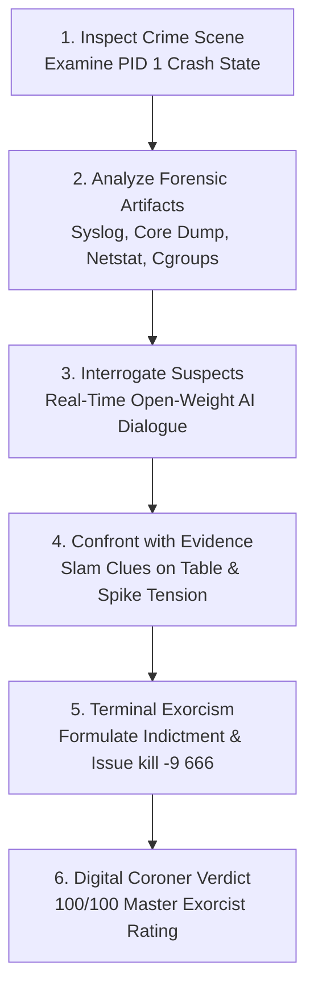

*This is a submission for the [Hacktoberfest Open-Source AI Challenge Week 4: Ghost in the Machine](https://dev.to/challenges/hacktoberfest-week4-2026-10-26).*

---

# EXORCIST.EXE // Case #1031: The Murder of PID 1
### *An Air-Gapped Cyber-Noir Forensic Interrogation & Operating System Exorcism Game*

> *"Every operating system is a metropolis of invisible workers. Threads spawn, execute, and terminate in silence. But at 03:42:19 UTC, the heartbeat of the mainframe went flat. The parent of all processes was assassinated in Ring 0. And one of your system daemons is harboring the ghost."*

---

## 🎮 Demo

Experience the forensic investigation live right now directly in your browser, or watch our complete 2-minute cinematic walkthrough:



* **▶️ Direct YouTube Walkthrough:** [Watch the 2-Minute Demo Video](https://youtu.be/7lLuG9szKVY)
* **🌐 Live Web Console (GitHub Pages):** [https://tribhu05.github.io/exorcist-exe/](https://tribhu05.github.io/exorcist-exe/)
* **🚀 1-Click Deploy on Render:** [Deploy on Render](https://render.com/deploy?repo=https://github.com/tribhu05/exorcist-exe)
* **▲ 1-Click Deploy on Vercel:** [Deploy on Vercel](https://vercel.com/new/clone?repository-url=https://github.com/tribhu05/exorcist-exe)

> **Zero Setup Required:** The live web version runs instantly with zero configuration, no external API keys, and no waiting for GPU containers.

---

## 💻 Code Repository

* **GitHub Repository:** [https://github.com/tribhu05/exorcist-exe](https://github.com/tribhu05/exorcist-exe)
* **License:** MIT License (100% Free & Open Source)
* **Stack:** Python 3.11+ / FastAPI / Ollama / Next.js 16 / React 19 / TypeScript / Tailwind CSS v4 / HTML5 Web Audio API

---

## 🕵️ What I Built: The Ghost in the Machine

**EXORCIST.EXE** is an interactive, atmospheric **Cyber-Noir Digital Forensics & Mystery Game** powered entirely by **open-weight AI running 100% locally and offline**.

Instead of building another passive LLM wrapper or generic Q&A bot, **EXORCIST.EXE** transforms low-level Linux systems programming and memory forensics into a gripping detective thriller. 

You play as **Detective Ray Trace**, an elite Digital Coroner summoned to Sector `0x7FFF` of a catastrophically failing Linux server.

```
+-------------------------------------------------------------------------+
| [CRIME LAB HUD] // CASE #1031-INIT-MURDER // AIR-GAPPED FORENSIC WORKBENCH |
+-------------------------------------------------------------------------+
| VICTIM:          init (PID 1, Parent of All Processes)                  |
| TIME OF DEATH:   03:42:19 UTC                                           |
| CRIME SCENE:     Ring 0 / Kernel Address Space 0x7FFF00000000            |
| WATCHDOG STATUS: T-MINUS 15:00 BEFORE HARDWARE KERNEL PANIC            |
+-------------------------------------------------------------------------+
```

### The Detained Suspects

Four core system daemons were trapped at the crime scene and placed in holding cells. One of them is the killer:

| Suspect Process | Role | Personality & Alibi |
| :--- | :--- | :--- |
| **`systemd`** (PID 12) | The Arrogant Supervisor | Pedantic, bureaucratic, defensive. Insists all unit configurations were strictly compliant and denies any supervisory oversight failure. |
| **`GarbageCollector`** (PID 88) | The Cynical Heap Janitor | World-weary, chain-smoking persona. Sweeps memory leaks and knows every dirty reference and dangling pointer in the heap. |
| **`CronDaemon`** (PID 256) | The Obsessive Clock-Watcher | High-strung, nervous, paranoid about clock drift down to the nanosecond. Has an airtight timestamped alibi. |
| **`Daemon 666`** (PID 666) | **The Phantom Socket** | An unmapped rogue process listening on raw socket streams. Speaks in corrupted hex, cryptic riddles, and glitching memory echoes. |

---

## ⚙️ Core Gameplay Mechanics



### 1. Interactive Open-Weight Interrogation Engine
Converse in real time with each suspect daemon. When running locally with **Ollama** (`gemma2:2b` or `llama3.2:3b`), each suspect uses dynamic system-prompt constraints, low-level OS terminology, and emotional state tracking.

### 2. Authentic Forensic Evidence Locker
You don't guess — you perform real systems triage:
* **Corrupted `/var/log/syslog`:** Timeline showing unauthorized socket initialization immediately preceding the watchdog heartbeat loss.
* **Stack Memory Hex Dump (`core.dump`):** Physical memory dump revealing a textbook buffer overflow:
  ```text
  0x7FFF0000: 41 41 41 41 41 41 41 41 41 41 41 41 41 41 41 41  AAAAAAAAAAAAAAAA
  0x7FFF0010: DE AD BE EF 00 00 00 00 66 02 00 00 00 00 00 00  ....RIP=0xDEADBEEF
  ```
* **Network Socket Table (`netstat -tulnp`):** Displays a hidden listening socket bound to `0.0.0.0:666` with zero registered binary backing on disk.
* **Control Group Telemetry (`/sys/fs/cgroup`):** Shows escaped memory limits and illicit Direct Memory Access (DMA) permissions granted through an unlinked inode.

### 3. Evidence Confrontation & Tension Spikes
Slamming physical clues onto the interrogation table breaks suspects out of their prepared scripts. When you confront **Daemon 666** with the `core.dump` buffer overflow signature:
* Its **Tension Gauge** surges from 15% to 95%.
* The CRT screen suffers violent visual glitch shaders and scanline distortions.
* Synthesized procedural static screams through the audio engine as the ghost's defense breaks down.

### 4. Terminal Indictment & Exorcism
When you've gathered sufficient evidence, trigger the terminal exorcism protocol:
1. Formulate the official indictment naming the perpetrator (`Daemon 666`).
2. Identify the fatal exploit vector (`Buffer Overflow / Instruction Pointer Hijack to 0x7FFFDEADBEEF`).
3. Enter the terminal kill switch:
   ```bash
   kill -9 666
   ```
4. If correct, the kernel failsafe aborts, the corrupt process is excised from memory, and the Digital Coroner awards your **100/100 Master Exorcist** ranking!

---

## 🌐 Why Open Innovation & Local AI Matter

For the Hacktoberfest 2026 challenge, the prompt asked us to examine the **"Ghost in the Machine"** through the lens of open-source artificial intelligence.

Proprietary closed-source AI APIs represent a growing threat to developer freedom, software sovereignty, and data privacy:
1. **The Privacy Hazard of Closed APIs:** In real-world digital forensics, reverse-engineering, and incident response, uploading proprietary core dumps, private stack traces, and internal server logs to a commercial cloud API is a catastrophic breach of confidentiality.
2. **The Air-Gapped Imperative:** Critical infrastructure, military networks, high-security financial vaults, and disaster response teams operate completely air-gapped from the public internet. Closed APIs simply cease to exist when the WAN cable is pulled.
3. **Open-Weight Autonomy:** Models like Google's **Gemma 2** and Meta's **Llama 3.2** prove that efficient, compact open-weight models running on consumer hardware can deliver nuanced, high-fidelity reasoning and complex multi-agent personas without sending a single byte to an external server.

**EXORCIST.EXE is 100% open-weight, 100% offline, and 100% yours.**

---

## 🏗️ Technical Architecture & Under the Hood

```
+-------------------------------------------------------------------------+
|                          CLIENT (BROWSER / CRT HUD)                     |
|  - Next.js 16 App Router + React 19 + TypeScript                        |
|  - Real-time Procedural HTML5 Web Audio Synthesizer (Zero MP3 Assets)   |
|  - CSS CRT Shaders, Phosphor Scanlines & Dynamic Text Glitch FX        |
|  - Dual Mode: Communicates with FastAPI OR switches to Offline Matrix   |
+-------------------------------------------------------------------------+
                                   |
                                   v (REST / JSON)
+-------------------------------------------------------------------------+
|                          BACKEND (FASTAPI CORONER)                      |
|  - Python 3.11+ / FastAPI Async API                                    |
|  - System Prompt Engine for 4 Daemon Personas                          |
|  - Dynamic Tension & Evidence Verification State Machine                |
|  - SQLite Incident Audit Log                                            |
+-------------------------------------------------------------------------+
                                   |
                                   v (Local IPC / HTTP)
+-------------------------------------------------------------------------+
|                      LOCAL OPEN-WEIGHT AI RUNTIME                       |
|  - Ollama Engine running local weights:                                 |
|    * gemma2:2b (Low latency, crisp deduction)                           |
|    * llama3.2:3b (High dramatic flair & glitch persona)                 |
|  - Heuristic Offline Matrix Fallback (Instant execution on zero-GPU)   |
+-------------------------------------------------------------------------+
```

### 1. Zero-Dependency Procedural Audio Engine
Instead of bundling megabytes of static audio files, EXORCIST.EXE synthesizes all retro sounds in real time using the native **HTML5 Web Audio API** ([`frontend/src/lib/audio.ts`](file:///frontend/src/lib/audio.ts)):
* **Keystroke Clicks:** Triangle wave oscillators with exponential decay mimicking mechanical IBM model M keyboards.
* **Tension Glitches:** White noise buffers modulated through bandpass filters to simulate dying hardware sockets.
* **Terminal Beeps & Exorcism Fanfare:** Dual-tone sine waves sounding authentic CRT boot alerts.

### 2. Resilient Dual-Layer Dialogue Architecture
To ensure anyone in the community can enjoy the experience regardless of their local hardware, EXORCIST.EXE features a seamless dual-engine architecture:
* **Online/Local Mode:** Connects to local FastAPI backend powered by Ollama.
* **Air-Gapped Static Mode:** When run on GitHub Pages or static hosts, an internal TypeScript deduction matrix ([`frontend/src/lib/offlineEngine.ts`](file:///frontend/src/lib/offlineEngine.ts)) dynamically handles suspect state, tension progression, evidence cross-examination, and indictment grading with zero server dependencies.

### 3. Dual Interfaces: Web HUD & Terminal CLI
Real systems programmers love the terminal. In addition to the Next.js CRT workstation, we built an authentic console interface using Python's `rich` library:

```bash
# Launch the Terminal Coroner directly in your terminal:
python cli/detective.py
```

---

## 🛠️ How to Run Locally

### Method 1: Automated 1-Click Launch (Windows PowerShell)
```powershell
git clone https://github.com/tribhu05/exorcist-exe.git
cd exorcist-exe
./run.ps1
```
Navigate to `http://localhost:3000`.

### Method 2: Docker Compose
```bash
docker-compose up --build
```

### Method 3: Manual Terminal Setup
```bash
# 1. Backend Setup
cd backend
python -m venv .venv
source .venv/bin/activate  # On Windows: .\.venv\Scripts\activate
pip install -r requirements.txt
uvicorn app.main:app --reload --port 8000

# 2. Frontend Setup (in a separate terminal)
cd ../frontend
npm install
npm run dev
```

---

## 🧪 Testing & Code Quality

EXORCIST.EXE includes an extensive automated test suite covering suspect persona isolation, evidence confrontation validation, indictment evaluation edge cases, and API uptime:

```bash
cd backend
pytest
```

```text
============================= test session starts =============================
platform win32 -- Python 3.14.0+, pytest-8.4.2, pluggy-1.6.0
collected 16 items

tests/test_api.py ................                                       [100%]

============================= 16 passed in 25.93s =============================
```

In addition, our GitHub Actions CI pipeline automatically runs pytest on every push, builds the Next.js static bundle, and deploys it directly to GitHub Pages.

---

## 🔮 What's Next for EXORCIST.EXE

* [ ] **Dynamic Case Generator:** Procedurally generate new kernel mysteries, rogue daemons, and randomized memory corruption offsets on every playthrough.
* [ ] **Local Multimodal Evidence:** Utilizing open-weight vision models (e.g., Llama 3.2 Vision) to allow players to upload and analyze raw Wireshark `.pcap` packet streams and real binary disassembly charts.
* [ ] **WebAssembly LLM Execution:** Compiling compact models directly into the browser via WebGPU/Wasm for client-side neural inference without requiring Ollama.

---

## 🎃 Conclusion

Hacktoberfest has always been about the spirit of open collaboration and empowering developers. With the dawn of open-weight artificial intelligence, that mission is more vital than ever.

**EXORCIST.EXE** proves that open-source models aren't just for coding assistants or enterprise search — they are a revolutionary creative canvas capable of immersing players in technical, educational, and unforgettable storytelling.

Check out the code, launch the investigation, and don't let your system become the next ghost in the machine!

* 🌟 **Star the Repo:** [github.com/tribhu05/exorcist-exe](https://github.com/tribhu05/exorcist-exe)
* 🎮 **Play Live:** [tribhu05.github.io/exorcist-exe/](https://tribhu05.github.io/exorcist-exe/)
* 📺 **Watch Demo:** [youtu.be/7lLuG9szKVY](https://youtu.be/7lLuG9szKVY)

*Happy Hacktoberfest 2026! 👻💻*
